```mermaid
---
config: {"flowchart": {"rankSpacing": 90, "subGraphTitleMargin": {"bottom": 24, "top": 0}}, "layout": "dagre", "theme": "base", "themeVariables": {"edgeLabelBackground": "#FFFFFF", "lineColor": "#56616C", "primaryTextColor": "#001736"}}
---
flowchart TB
    subgraph n244210e48437b6556980a70249a99369934a352429034cef9d7bd253b3bf2c01["`project: Helm README generator`"]
        n2ad562319767157087dda0dec6391f4479f8a04869ab0cc8d3a9c3637dae73b5["branch: fix/structural-values-schemas (review)"]
        n0d6e4079e36703ebd37c00722f5891d28b0e2811dc114b129215123adcce3605["branch: main"]
        nc97ace4c8fef2cee8fa0f3c9f52aab18dbd4f42438afe362ffb8f75ce4c04b84["review #35;1: Structural Helm values schemas (open#59; review)"]
    end
    n2ad562319767157087dda0dec6391f4479f8a04869ab0cc8d3a9c3637dae73b5 -->|based on| n0d6e4079e36703ebd37c00722f5891d28b0e2811dc114b129215123adcce3605
    nc97ace4c8fef2cee8fa0f3c9f52aab18dbd4f42438afe362ffb8f75ce4c04b84 ---|correlates| n2ad562319767157087dda0dec6391f4479f8a04869ab0cc8d3a9c3637dae73b5
    click n2ad562319767157087dda0dec6391f4479f8a04869ab0cc8d3a9c3637dae73b5 href "https://github.com/astrivant/readme-generator-for-helm/tree/fix/structural-values-schemas" "Open recorded work" _blank
    click n0d6e4079e36703ebd37c00722f5891d28b0e2811dc114b129215123adcce3605 href "https://github.com/astrivant/readme-generator-for-helm/tree/main" "Open recorded work" _blank
    click nc97ace4c8fef2cee8fa0f3c9f52aab18dbd4f42438afe362ffb8f75ce4c04b84 href "https://github.com/astrivant/readme-generator-for-helm/pull/1" "Open recorded work" _blank
    classDef work fill:#FFFFFF,stroke:#56616C,color:#001736
    class n2ad562319767157087dda0dec6391f4479f8a04869ab0cc8d3a9c3637dae73b5 work
    class n0d6e4079e36703ebd37c00722f5891d28b0e2811dc114b129215123adcce3605 work
    style n244210e48437b6556980a70249a99369934a352429034cef9d7bd253b3bf2c01 fill:#FFFFFF,stroke:#007E54,color:#001736
    class nc97ace4c8fef2cee8fa0f3c9f52aab18dbd4f42438afe362ffb8f75ce4c04b84 work
    linkStyle 0 stroke:#007E54,color:#001736
    linkStyle 1 stroke:#B76A62,color:#001736
```

- [Helm README generator](https://github.com/astrivant/readme-generator-for-helm)
- [main](https://github.com/astrivant/readme-generator-for-helm/tree/main)
- [fix/structural-values-schemas](https://github.com/astrivant/readme-generator-for-helm/tree/fix/structural-values-schemas)
- [Structural Helm values schemas](https://github.com/astrivant/readme-generator-for-helm/pull/1)
